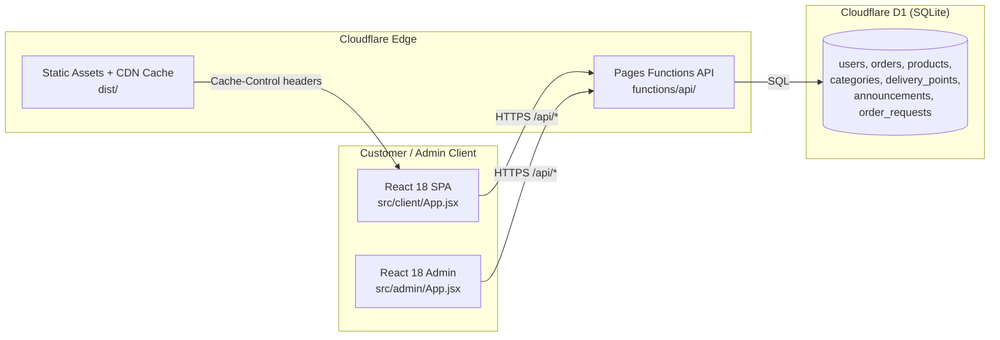
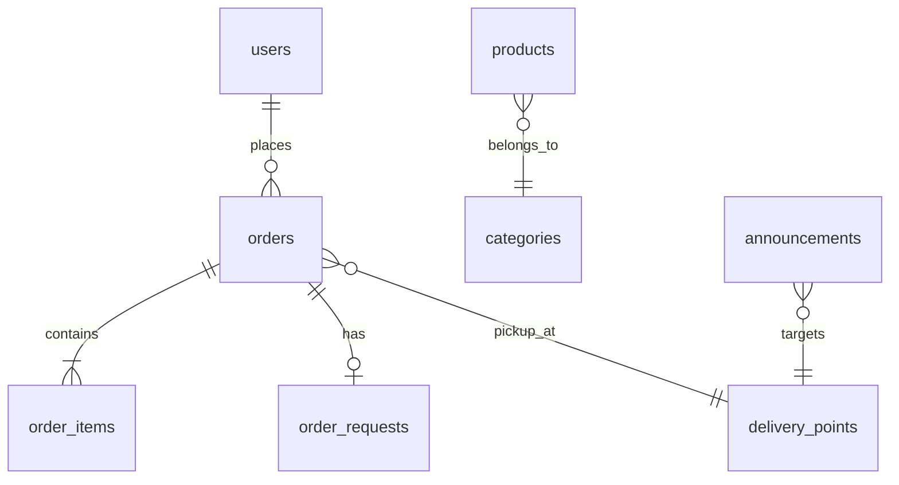
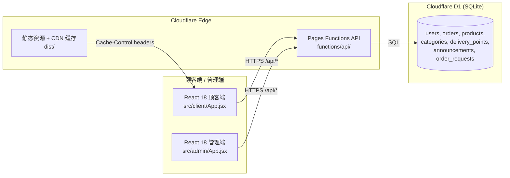

# Jenny Fresh Produce — Order System

<p align="center">
  <a href="https://jennyfresh.com/"></a>
  <a href="https://react.dev"></a>
  <a href="https://vitejs.dev"></a>
  <a href="https://pages.cloudflare.com"></a>
  <a href="https://developers.cloudflare.com/d1/"></a>
  <a href="#testing"></a>
  <a href="#license"></a>
</p>

> A lightweight group-buying e-commerce solution for HKUST campus fresh produce.  
> Customers scan a QR code or visit the web to order, group by pickup point, and enjoy consolidated delivery.  
> The backend handles payment-proof uploads, order state machines, and admin reconciliation.

---

## Features

| Module | Highlights |
|--------|------------|
| **Product Browsing** | Category browsing, keyword search, favorites, hot/new tags, multi-variant SKUs, admin on/off switch |
| **Trilingual UI** | Simplified Chinese / Traditional Chinese / English — switchable at runtime |
| **Dual Currency** | Display in ¥CNY or HK$; exchange rate adjustable in the admin dashboard |
| **Group Delivery** | Pickup points with free self-collection; consolidated delivery once the point threshold is met; home delivery +¥30 |
| **Transfer Payment** | WeChat Pay / Alipay (CNY) and FPS (HKD). Upload a payment screenshot for manual confirmation |
| **Announcements & Contact** | Point-targeted delivery announcements; WeChat / WhatsApp / FPS contacts with one-tap copy |
| **Admin Dashboard** | Product / order / user / announcement / exchange-rate management; order state machine & refund/delivery-upgrade approvals |

## Tech Stack

| Layer | Technology |
|-------|------------|
| Frontend | React 18 + Vite 5 (SPA, legacy plugin for older browsers) |
| Backend | Cloudflare Pages Functions (native JS, `functions/api/`) |
| Database | Cloudflare D1 (SQLite) |
| Auth | PBKDF2 password hashing + Bearer token |
| i18n | Front-end translation tables (`src/client/i18n.js`) |
| Test | Node.js native test runner (`node --test`) |
| Deploy | `npm run build && wrangler pages deploy dist` |

## Architecture

### Request Flow



### Core Data Model



## Directory Structure

```
order-system/
├── functions/api/              # Cloudflare Pages Functions (backend API)
│   ├── _utils.js               # Auth, password hashing, CORS, JSON helpers
│   ├── _contacts.js            # Phone / WeChat ID normalization
│   ├── _phone.js               # Phone validation
│   ├── _account.js             # Account helpers
│   ├── _seed-descriptions.js   # Product seed data
│   ├── admin/                  # Admin-only endpoints
│   │   ├── login.js
│   │   ├── orders.js
│   │   ├── orders/[id].js      # GET / PATCH / PUT / DELETE
│   │   ├── order-requests.js
│   │   ├── users.js
│   │   ├── users/[id].js
│   │   └── settings.js         # Exchange-rate CRUD
│   ├── categories.js
│   ├── categories/[id].js
│   ├── products.js
│   ├── products/[id].js
│   ├── orders.js               # Customer order creation & list
│   ├── orders/[id].js
│   ├── orders/request.js       # Delivery-upgrade / refund requests
│   ├── orders/upload-proof.js  # Payment screenshot upload
│   ├── login.js
│   ├── register.js
│   ├── me.js
│   ├── stats.js                # Group-progress per pickup point
│   ├── announcements.js
│   ├── delivery-points.js
│   ├── settings.js
│   ├── seed-products.js
│   ├── update-product-images.js
│   └── clear-product-images.js
├── migrations/                 # D1 schema & data patches
│   ├── schema.sql
│   ├── seed.sql
│   ├── update-images.sql
│   ├── product-catalog-repair.sql
│   ├── payment-currency-2026-10.sql
│   ├── reclassify-produce-2026-10.sql
│   ├── 2026-10-17-user-management.sql
│   └── 2026-10-17-account-and-content-languages.sql
├── scripts/                    # One-off migration scripts
│   ├── upgrade-db.mjs
│   ├── migrate-user-management.mjs
│   └── migrate-account-content.mjs
├── src/
│   ├── client/
│   │   ├── App.jsx             # Customer SPA
│   │   └── i18n.js             # zh_CN / zh_HK / en UI strings
│   ├── admin/
│   │   ├── App.jsx             # Admin SPA
│   │   └── UserManage.jsx
│   ├── storage.js              # Safe localStorage wrapper
│   ├── useVisualViewport.js
│   ├── client.css
│   ├── admin.css
│   └── main.jsx                # Vite entry point
├── tests/                      # Node native test runner
│   ├── api.test.mjs
│   ├── business-flow.test.mjs
│   ├── account-content.test.mjs
│   ├── admin-users.test.mjs
│   ├── phone-login.test.mjs
│   ├── i18n.test.mjs
│   └── storage.test.mjs
├── public/                     # Static assets, headers & redirects
│   ├── images/products/
│   ├── assets/
│   ├── _headers
│   └── _redirects
├── docs/                       # Delivery notes (not rendered on site)
├── index.html
├── vite.config.js
├── wrangler.toml
├── package.json
└── update-products.mjs
```

## Quick Start

```bash
# 1. Install dependencies
npm install

# 2. Initialize the local D1 database
npm run db:init

# 3. Seed sample products & delivery points
npm run db:seed

# 4. Start the dev server (Vite on :3000, API proxied to :8788)
npm run dev

# 5. Run the test suite
npm test
# Expected: 35 passing

# 6. Production build
npm run build
# Expected: dist/ with hashed assets and wechat.html

# 7. Deploy (requires Cloudflare auth)
npm run deploy
```

> **First admin setup:** Register a customer account, then set `users.is_admin = 1` directly in the database. There is no public admin-creation endpoint.

## Business Rules

| Rule | Detail |
|------|--------|
| **Pickup delivery fee** | Always ¥0 for pickup-point orders. |
| **Group threshold** | Each point has its own threshold (default ¥1000; HKUST point ¥500). When the sum of **confirmed-payment + pending-delivery** orders at that point reaches the threshold, the owner arranges consolidated delivery. Progress is cumulative across days and resets only after shipment. |
| **Home delivery fee** | Flat ¥30 per order. |
| **Currency base** | All prices, thresholds, and fees are stored and calculated in CNY. HKD display uses the admin-adjustable exchange rate (default 1 CNY = 1.2 HKD). |
| **Payment method ↔ currency** | WeChat Pay / Alipay → CNY only. FPS → HKD only. |
| **Order status flow** | `pending` → `awaiting_confirmation` → `paid` → `shipped` → `completed`. Cancellation requires refund if already paid. |
| **Refund / upgrade** | Only pickup orders with `paid` + `confirmed` payment may request a refund or upgrade to home delivery (+¥30). The owner handles payment offline and confirms in the dashboard. |
| **Payment proof** | PNG / JPEG / WebP, max 1 MB. Cannot be re-uploaded after confirmation. |

## Testing

```bash
npm test
```

The suite runs `node --test tests/*.test.mjs` and currently contains **35 passing assertions**.

| Test file | Coverage |
|-----------|----------|
| `api.test.mjs` | Order creation, product listing, admin order/settings CRUD, stats, payment-proof upload |
| `business-flow.test.mjs` | Delivery-upgrade & refund requests, announcements, group-progress aggregation |
| `account-content.test.mjs` | Username signup, multilingual content fields, admin order state transitions |
| `admin-users.test.mjs` | Admin user CRUD, profile updates, permission checks |
| `phone-login.test.mjs` | HK / mainland phone registration, password hashing, login flow |
| `i18n.test.mjs` | Translation completeness, interpolation consistency, no leaked CJK literals |
| `storage.test.mjs` | localStorage corruption resilience and in-memory fallback |

## Deployment

```bash
npm run deploy
```

This runs `npm run build && wrangler pages deploy dist`.  
The production database is separate from the local one; use `--remote` with Wrangler D1 commands when operating on production.

> **Online version:** The live site is at [https://jennyfresh.com/](https://jennyfresh.com/). For the exact deployed revision, please refer to the latest deployment.

## Honest Notes

- **Favorites & search history** are stored in the browser’s `localStorage`. They will be lost if the cache is cleared or the device is changed.
- **Product / category / pickup-point names** are translated via front-end mapping tables (`productNameMap`, `categoryNameMap`, `pointNameMap` in `src/client/App.jsx`), not by a real-time translation service.
- **Announcements** appear on the customer home page but are **not** automatically pushed to WeChat groups.
- **Inventory (`stock`)** is advisory; the system does not lock stock at checkout.
- Some features (exchange-rate updates, point-specific announcements) require the app to be deployed to Cloudflare and connected to a live D1 database.

## License

This project does not currently include an open-source license. All rights reserved.

---

# 珍珍优质果菜订购系统

<p align="center">
  <a href="https://jennyfresh.com/"></a>
  <a href="https://react.dev"></a>
  <a href="https://vitejs.dev"></a>
  <a href="https://pages.cloudflare.com"></a>
  <a href="https://developers.cloudflare.com/d1/"></a>
  <a href="#测试"></a>
  <a href="#许可证"></a>
</p>

> 面向香港科技大学校园的轻量果蔬拼单团购系统。  
> 顾客扫码或访问网页下单，按自取点凑单，满额后统一配送，后台人工核账。  
> 链接：[https://jennyfresh.com/](https://jennyfresh.com/)

---

## 功能清单

| 模块 | 说明 |
|------|------|
| **商品浏览** | 分类浏览、关键词搜索、收藏、热销/新品标签、多规格 SKU、后台上下架 |
| **三语切换** | 简体 / 繁體 / English，运行时一键切换 |
| **双币种显示** | ¥CNY / HK$ 展示，后台可调汇率 |
| **拼单配送** | 自取免运费；按点凑满门槛统一配送；送货到家 ¥30；UST 学生点满 ¥500 |
| **转账支付** | 微信/支付宝（CNY）、转数快 FPS（HKD），上传付款凭证截图人工确认 |
| **公告与联系** | 按自取点定向配送公告；微信/WhatsApp/转数快联系方式一键复制 |
| **管理后台** | 商品/订单/用户/公告/汇率管理；订单状态机与退款/加配送申请审批 |

## 技术栈

| 层级 | 技术 |
|------|------|
| 前端 | React 18 + Vite 5（单页应用，含 legacy 插件兼容旧浏览器） |
| 后端 | Cloudflare Pages Functions（原生 JS，`functions/api/`） |
| 数据库 | Cloudflare D1（SQLite） |
| 认证 | PBKDF2 密码哈希 + Bearer Token |
| 国际化 | 前端译名表（`src/client/i18n.js`） |
| 测试 | Node.js 原生测试运行器（`node --test`） |
| 部署 | `npm run build && wrangler pages deploy dist` |

## 架构图

### 请求链路



### 核心数据表关系


## 目录结构

```
order-system/
├── functions/api/              # Cloudflare Pages Functions（后端 API）
│   ├── _utils.js               # 认证、密码哈希、CORS、JSON 辅助函数
│   ├── _contacts.js            # 电话 / 微信 ID 规范化
│   ├── _phone.js               # 电话校验
│   ├── _account.js             # 账户辅助
│   ├── _seed-descriptions.js   # 商品种子数据
│   ├── admin/                  # 管理端接口
│   │   ├── login.js
│   │   ├── orders.js
│   │   ├── orders/[id].js      # GET / PATCH / PUT / DELETE
│   │   ├── order-requests.js
│   │   ├── users.js
│   │   ├── users/[id].js
│   │   └── settings.js         # 汇率增删改查
│   ├── categories.js
│   ├── categories/[id].js
│   ├── products.js
│   ├── products/[id].js
│   ├── orders.js               # 顾客下单与订单列表
│   ├── orders/[id].js
│   ├── orders/request.js       # 加配送 / 退款申请
│   ├── orders/upload-proof.js  # 付款凭证上传
│   ├── login.js
│   ├── register.js
│   ├── me.js
│   ├── stats.js                # 各点拼单进度
│   ├── announcements.js
│   ├── delivery-points.js
│   ├── settings.js
│   ├── seed-products.js
│   ├── update-product-images.js
│   └── clear-product-images.js
├── migrations/                 # D1 表结构及数据补丁
│   ├── schema.sql
│   ├── seed.sql
│   ├── update-images.sql
│   ├── product-catalog-repair.sql
│   ├── payment-currency-2026-10.sql
│   ├── reclassify-produce-2026-10.sql
│   ├── 2026-10-17-user-management.sql
│   └── 2026-10-17-account-and-content-languages.sql
├── scripts/                    # 一次性迁移脚本
│   ├── upgrade-db.mjs
│   ├── migrate-user-management.mjs
│   └── migrate-account-content.mjs
├── src/
│   ├── client/
│   │   ├── App.jsx             # 顾客端 SPA
│   │   └── i18n.js             # 简体 / 繁體 / 英文 UI 文案
│   ├── admin/
│   │   ├── App.jsx             # 管理端 SPA
│   │   └── UserManage.jsx
│   ├── storage.js              # 安全的 localStorage 包装
│   ├── useVisualViewport.js
│   ├── client.css
│   ├── admin.css
│   └── main.jsx                # Vite 入口
├── tests/                      # Node 原生测试
│   ├── api.test.mjs
│   ├── business-flow.test.mjs
│   ├── account-content.test.mjs
│   ├── admin-users.test.mjs
│   ├── phone-login.test.mjs
│   ├── i18n.test.mjs
│   └── storage.test.mjs
├── public/                     # 静态资源、响应头与重定向规则
│   ├── images/products/
│   ├── assets/
│   ├── _headers
│   └── _redirects
├── docs/                       # 交付说明（不在站点渲染）
├── index.html
├── vite.config.js
├── wrangler.toml
├── package.json
└── update-products.mjs
```

## 快速开始

```bash
# 1. 安装依赖
npm install

# 2. 初始化本地 D1 数据库
npm run db:init

# 3. 导入示例商品与自取点
npm run db:seed

# 4. 启动开发服务器（Vite :3000，API 代理到 :8788）
npm run dev

# 5. 运行测试
npm test
# 预期结果：35 项全部通过

# 6. 生产构建
npm run build
# 预期结果：输出 dist/，含哈希资源与 wechat.html

# 7. 部署（需要 Cloudflare 授权）
npm run deploy
```

> **首次设置管理员：** 先注册一个普通账号，再在数据库中将其 `users.is_admin` 设为 `1`。系统不提供公开的管理员注册接口。

## 业务规则说明

| 规则 | 说明 |
|------|------|
| **自取运费** | 自取点订单始终免运费。 |
| **拼单门槛** | 每个点独立门槛（默认 ¥1000；科技大学点 ¥500）。仅统计**已确认收款且待配送**的订单金额，跨天累计，发货后退出进度。 |
| **到家运费** | 固定 ¥30/单。 |
| **币种基准** | 商品金额、门槛、运费均以 CNY 保存与计算；前台选 HKD 时按后台汇率换算（默认 1 CNY = 1.2 HKD）。 |
| **支付方式与币种对应** | 微信/支付宝仅支持 CNY；转数快 FPS 仅支持 HKD。 |
| **订单状态流** | `pending` → `awaiting_confirmation` → `paid` → `shipped` → `completed`。已收款订单取消须先退款。 |
| **退款 / 加配送** | 仅“已确认收款、待统一配送”的自取订单可申请。退款由店主线下退还后在后台标记；加配送额外收取 ¥30，线下支付后后台确认。 |
| **付款凭证** | 限 PNG / JPEG / WebP，最大 1 MB；确认收款后不可再次上传。 |

## 测试说明

```bash
npm test
```

执行 `node --test tests/*.test.mjs`，目前共 **35 项全部通过**。

| 测试文件 | 覆盖范围 |
|----------|----------|
| `api.test.mjs` | 下单流程、商品列表、后台订单/设置 CRUD、拼单统计、凭证上传 |
| `business-flow.test.mjs` | 加配送与退款申请、公告、拼单进度聚合 |
| `account-content.test.mjs` | 用户名注册、多语言内容字段、后台订单状态流转 |
| `admin-users.test.mjs` | 后台用户增删改、资料更新、权限校验 |
| `phone-login.test.mjs` | 香港/内地手机号注册、密码哈希、登录流程 |
| `i18n.test.mjs` | 三语完整性、插值一致性、无未翻译中文硬编码 |
| `storage.test.mjs` | localStorage 数据损坏容错与内存降级 |

## 部署方式

```bash
npm run deploy
```

即 `npm run build && wrangler pages deploy dist`。  
生产数据库与本地数据库相互独立；对生产 D1 执行操作请加上 `--remote`。

> **线上版本：** [https://jennyfresh.com/](https://jennyfresh.com/)。具体部署版本请以最新部署为准。

## 诚实边界

- **收藏与搜索历史**保存在浏览器 `localStorage`，换设备或清理缓存会丢失。
- **商品名、分类名、自取点名**的多语言展示由前端译名表映射（`productNameMap`、`categoryNameMap`、`pointNameMap`），非后端实时翻译。
- **网站公告**仅在前端展示，不会自动发送到微信群。
- **库存（`stock`）**为参考值，系统目前不在下单时锁定库存。
- 部分功能（汇率调整、按点公告）需要部署到 Cloudflare 并连接线上 D1 后才生效。

## 许可证

本项目暂未设置开源许可证，所有权利保留。
